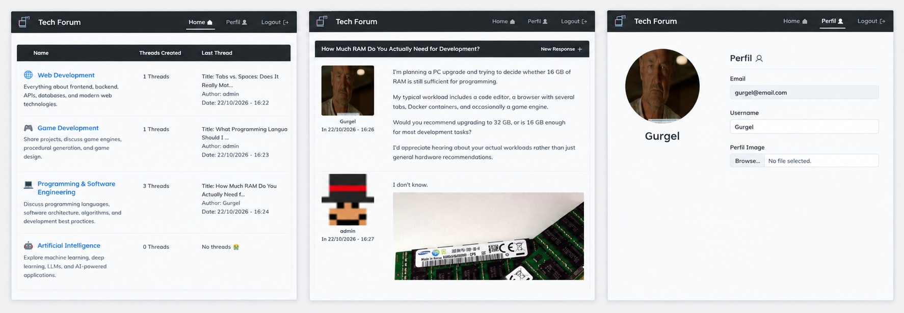

# Tech Forum

<p align="center" >
  <!-- Substitua o link do src pela sua imagem/gif de demonstração, se tiver -->
  
</p>


Tech Forum is an online technology discussion forum where users can browse discussion categories, create threads, and share replies.

## Project Background

The project was originally developed as part of a **Web Development** course. Its first backend implementation used **Strapi**, while the frontend was built with Vue.js.

Later, a second backend was developed using **Node.js, Express, Prisma, and SQLite**. The main motivation was that the original Strapi implementation had become outdated. The new backend reimplements the API while aiming to preserve compatibility with the existing frontend, reducing the need to rewrite its Vue components and Axios requests.

The repository therefore reflects two stages of the project: the original Strapi-based implementation and the newer Node.js backend.

## Features

- Browse discussion categories, threads, and replies without signing in.
- Register an account and log in.
- Create threads and reply to existing discussions.
- Update your profile, including its profile image.
- Manage your own threads and replies.
- Allow administrators to manage categories, moderate users, pin threads, and moderate discussions.
- Upload profile images.

## User Roles

- **Guest:** can browse categories, threads, and replies.
- **Registered user:** can participate in discussions and manage their own content and profile.
- **Administrator:** can manage categories and users, moderate discussions, and pin threads.

## Data Model

The main entities are:

- **User** — account information, role, and profile image.
- **ThreadSet** — a category or group of threads.
- **Thread** — a discussion created by a user and associated with a category.
- **Response** — a reply associated with a thread and its author.
- **UploadedFile** — metadata for uploaded images.

## Technologies

### Frontend

- Vue.js 3
- Vue Router
- Pinia
- Axios

### Original Backend

- Strapi

### New Backend

- Node.js 20+
- Express
- Prisma ORM
- SQLite
- JSON Web Tokens (JWT) for authentication
- Multer for image uploads

## Running the Node.js Backend

### Requirements

- Node.js 20 or later
- npm

### Setup

Run the following commands from the directory containing the Node.js backend's `package.json`:

1. Install dependencies:

   ```bash
   npm install
   ```

2. Create a local environment file:

   ```bash
   cp .env.example .env
   ```

3. Edit `.env`. Set a strong, unique value for `JWT_SECRET`, and configure `ADMIN_EMAIL` and `ADMIN_PASSWORD` for the administrator account. Do not commit `.env` or real credentials to version control.

4. Generate the Prisma Client and apply the database migrations:

   ```bash
   npm run db:generate
   npm run db:migrate
   ```

5. Create or promote the configured administrator account:

   ```bash
   npm run db:seed
   ```

6. Start the development server:

   ```bash
   npm run dev
   ```

By default, the API runs at `http://localhost:1337`. Check `http://localhost:1337/health` to verify that the server is running.

The backend accepts both regular paths (such as `/threads`) and paths prefixed with `/api` (such as `/api/threads`) to support Axios configurations originally made for Strapi.

### Available Scripts

| Command | Description |
| --- | --- |
| `npm run dev` | Starts the development server with automatic restarts. |
| `npm start` | Starts the server. |
| `npm run db:generate` | Generates the Prisma Client. |
| `npm run db:migrate` | Applies database migrations in development. |
| `npm run db:deploy` | Applies existing migrations, suitable for deployment. |
| `npm run db:seed` | Creates or promotes the administrator configured in `.env`. |
| `npm run db:studio` | Opens Prisma Studio to inspect the database. |

## API Overview

The new backend provides the following main endpoints. Authenticated routes require a valid JWT; administrator-only operations require an administrator account.

| Method | Endpoint | Access |
| --- | --- | --- |
| `GET` | `/health` | Public |
| `POST` | `/auth/local/register` | Public |
| `POST` | `/auth/local` | Public |
| `GET` | `/users/me` | Authenticated |
| `GET` | `/users` | Administrator |
| `GET`, `PUT` | `/users/:id` | Owner or administrator, with privileged fields restricted to administrators |
| `GET` | `/thread-sets`, `/thread-sets/:id` | Public |
| `POST`, `PUT`, `DELETE` | `/thread-sets`, `/thread-sets/:id` | Administrator |
| `GET` | `/threads`, `/threads/:id` | Public |
| `POST` | `/threads` | Authenticated |
| `PUT`, `DELETE` | `/threads/:id` | Thread author or administrator; pinning is administrator-only |
| `GET` | `/responses`, `/responses/:id` | Public |
| `POST` | `/responses` | Authenticated |
| `PUT`, `DELETE` | `/responses/:id` | Response author or administrator, with thread-author deletion permissions supported |
| `POST` | `/upload` | Authenticated |
| `DELETE` | `/upload/files/:id` | Authenticated, subject to ownership rules |

Collection endpoints support the filters and response shapes used by the Vue frontend. The API also supports the optional `/api` prefix to maintain compatibility with requests originally written for Strapi.

## Project Author

Gustavo Gurgel Medeiros — Computer Science
